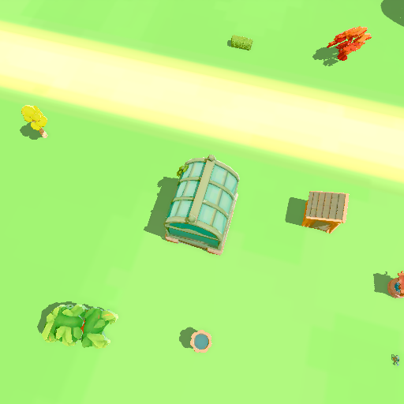
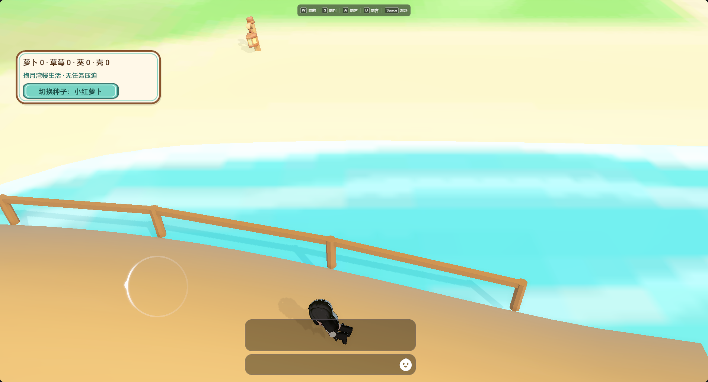
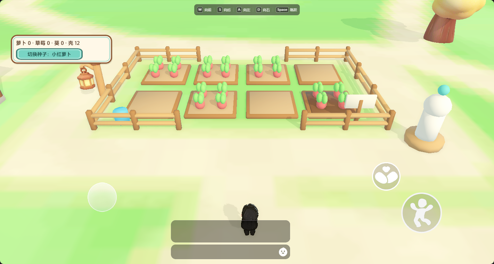

# 《时光小筑 · 抱月湾 2.5D》

《时光小筑 · 抱月湾》是用抖音造世界、Hamlet Lua 5.3 和 Unity Runtime 制作的海湾生活游戏。玩家可以散步、种菜，并和动物邻居聊天、送礼。

## 2026-11-27 更新

- **三种作物的收获动画。** 摘下小红萝卜、甜草莓或向日葵时，主角会抱起对应作物，蹬地起跳并在空中转一圈，落地后单手举起作物摆造型。三种作物各有适合自身尺寸和形状的握持位置。[收获脚本](workspace/scripts/lua-25d/farming-plot-system.lua)
- **走跑和跳跃。** 移除了收获动画对主角移动速度、跳跃高度和动画播放器的临时改写。在造世界里连续测试了三种作物的道具显示、背包数量加一和道具收起，随后按 `W` 跑动、按空格跳跃并落地。
- **新增 27 件场景素材。** 北麓花园新增玻璃房、观景亭、钟楼、水井和园艺工具房，东湾街区新增面包房、双层民居、樱花树与盆栽，庭院果园和西翼坡地补充了树木、灌木和岩石。各模型可独立编辑，已核对运行态可见、落在地形上，摆位避开主要道路。[摆位清单](workspace/data/windwaker_supplemental_placements.json) · [模型源文件](workspace/assets/models/supplemental/)



[恢复造世界工程](本次打包与恢复说明.md) · [最新可编辑 WPrefab](workspace/exports/shiguang-25d-windwaker-v7-supplemental.wprefab) · [下一步待办](下一步待办清单.md)

## v2–v3 核心特性与技术记录

| 模块 | 实现方案与当前指标 | 关键产出入口 |
| :--- | :--- | :--- |
| **连续平滑地形 & 伪无边界海景** | 以参考《塞尔达传说：风之杖》明快绘本色板重建连续抱月湾地形，`L0 (+0.25m)` → `L3 (+3.10m)` 缓坡过渡，12 条核心路线实测最大坡度 **`12.38°`**（`≤ 12.5°`）；配套 `1440m × 1440m` 外海平面 + 14 座远景剪影离岛与隐形海岸碰撞围栏（`Invisible_Sea_Boundary_*` 设为 `transparency: 0, castShadows: false` 隐身）。 | [build_windwaker_terrain.py](workspace/scripts/build_windwaker_terrain.py) · [windwaker_terrain_heights.json](workspace/data/windwaker_terrain_heights.json) · [map-windwaker-bay.glb](workspace/assets/models/map-windwaker-bay.glb) · [env-windwaker-sea-horizon.glb](workspace/assets/models/env-windwaker-sea-horizon.glb) |
| **2.5D 固定斜俯视相机** | 通过 `DouyinCameraService` 锁定斜俯视跟随角度（`Pitch = 36°`、`Yaw = 0°`、`Distance = 15.5m`、`TargetOffsetY = 1.15m`），兼顾 WASD 与左下角虚拟摇杆操作，并在运行时自动隐藏海界围栏渲染器。 | [camera-25d-controller.lua](workspace/scripts/lua-25d/camera-25d-controller.lua) |
| **8 格轻种菜玩法** | 独立保留 `Plot_1..Plot_8` 干土/湿土及三阶段作物节点（`nodeMergeBlacklist` 精确放行 64 条路径）；支持小红萝卜（25s）/ 甜草莓（35s）/ 向日葵（45s）轮播切换、浇水成熟时间减半、永久不枯萎、`DouyinDataStore` 轻存档与靠近交互提示。 | [build_farm_and_placeholders.py](workspace/scripts/build_farm_and_placeholders.py) · [farming-plot-system.lua](workspace/scripts/lua-25d/farming-plot-system.lua) · [model-farm-garden.glb](workspace/assets/models/model-farm-garden.glb) |
| **底部对话盒 + 左侧动画立绘** | 按玩家手绘草图制作 `1920×1080` 静态 HTML + SVG 皮肤，下方宽幅对话框叠加左侧圆角透明立绘框（8 FPS 轮播 `amuFrame01..06.png` / `mianmianFrame01..04.png`），对话期间 3D NPC 保持静止且调用 `DouyinUIService.HideUI()` 隐藏系统摇杆，支持赠礼与关闭恢复；附离线绿幕视频转透明序列帧工具。 | [1920x1080.html](workspace/assets/ui-dialogue-25d/html/1920x1080.html) · [dialogue-25d-ui.lua](workspace/scripts/lua-25d/dialogue-25d-ui.lua) · [greenscreen_to_frames.py](workspace/scripts/greenscreen_to_frames.py) · [make_demo_portrait_frames.py](workspace/scripts/make_demo_portrait_frames.py) |
| **Tripo 3D 资产减面与云端归档** | 将 8 个高面数 Tripo FBX 建筑/树/路灯道具减面压缩为 `< 1.2 MB` 引擎可用 GLB 并归档上云；2 位 NPC（`NPC_Amu`、`NPC_Mianmian`）暂以轻量化占位模型替代，待外部骨骼绑定全部完成后无缝替换。 | [decimate_tripo_assets.py](workspace/scripts/decimate_tripo_assets.py) · [tripo-optimized/](workspace/assets/models/tripo-optimized) · [windwaker_asset_uris.json](workspace/data/windwaker_asset_uris.json) |

---

## v2–v3 阶段视觉预览

| Blender 2.5D 地形与海景渲染预览 | 实机运行态：西跨海拱桥与礁岸浅滩（Check B） | 实机运行态：主庭院出生点与 8 格菜园（Check A） |
| :---: | :---: | :---: |
|  |  |  |

> 注：右图 [ww-runtime-spawn-25d.png](workspace/debug/ww-runtime-spawn-25d.png) 为 **v2** 运行态截图；随后的 **v3** UI 构建（已归档为 `eitflflegg6eihqv.wprefab`）已移除左上角胶囊内的 `"抱月湾慢生活 · 无任务压迫"` 等设计术语文案并收紧卡片尺寸，将在复工后补采最终截图验收。

---

## 仓库目录导览

| 目录 / 文件 | 用途说明 | 代表入口 |
| :--- | :--- | :--- |
| **`README.md` & `HANDOFF.md`** | 阶段总览与交接恢复手册 | [HANDOFF.md](HANDOFF.md) |
| **`项目理解与总览.md`** | 前期 4× 世界观、平台约束调研与工程笔记（历史基线留档） | [项目理解与总览.md](项目理解与总览.md) |
| **`workspace/scripts/`** | 2.5D 地形/菜园/减面/绿幕抠像脚本、Lua 5.3 玩法源码与 Scene SDK 装配脚本 | [prepare_scene_manifest.py](workspace/scripts/prepare_scene_manifest.py) · [deliver_wprefab_to_scene.py](workspace/scripts/deliver_wprefab_to_scene.py) · [assemble_windwaker_prefab.js](workspace/scripts/assemble_windwaker_prefab.js) |
| **`workspace/assets/`** | 2.5D UI 源码（`ui-dialogue-25d/`）、Blender 导出模型及减面后 Tripo GLB、62 项特写图集 | [ui-dialogue-25d/meta.json](workspace/assets/ui-dialogue-25d/meta.json) · [tripo-optimized/](workspace/assets/models/tripo-optimized) |
| **`workspace/data/`** | 2.5D 资产 URI 清单、地形高程与坡度审计表、环境参数补丁、交付回执与叙事库 | [windwaker_scene_manifest.json](workspace/data/windwaker_scene_manifest.json) · [windwaker_delivery_receipt.json](workspace/data/windwaker_delivery_receipt.json) · [windwaker_env_patch.json](workspace/data/windwaker_env_patch.json) |
| **`workspace/debug/`** | Blender 渲染预览与实机运行态验收截图 | [windwaker-bay-overview.png](workspace/debug/windwaker-bay-overview.png) · [farm-garden-preview.png](workspace/debug/farm-garden-preview.png) · [tripo-optimized-preview.png](workspace/debug/tripo-optimized-preview.png) |
| **`interactive-demos/`** | 早期零依赖浏览器端交互原型与蓝图 | [shiguang-narrative-game.html](interactive-demos/shiguang-narrative-game.html) · [town-layout-blueprint-4x.html](interactive-demos/town-layout-blueprint-4x.html) |
| **`creator-project/`** | 早期 v1 造世界本地工程快照（`ui-town-interaction` 及初代脚本留档；现行工程快照位于下方恢复说明所列的项目目录） | [project.json](creator-project/project-a9b73cc9-cfbc-4006-a8df-f5f44f1279a5/project.json) |
| **`图片/`** | 角色 T-Pose 参考图、62 项分包图集与联络表（原始未减面 `.fbx` / `.fbm` 由 `.gitignore` 忽略） | [图片/manifest.json](图片/manifest.json) |

---

## 常用本地命令速查

### 1. 重建连续地形与伪无边界海景 GLB（Blender 5.3）
```powershell
& "C:\Program Files\Blender Foundation\Blender 5.3\blender.exe" -b --factory-startup -P "workspace\scripts\build_windwaker_terrain.py" -- --blender
```

### 2. 离线将绿幕人物视频转为对话 UI 透明序列帧
```powershell
# 运行内建绿幕自检
python "workspace\scripts\greenscreen_to_frames.py" --self-test

# 实际转换绿幕视频（mp4/mov/webm -> UI 左侧立绘 8fps 透明帧序列）
python "workspace\scripts\greenscreen_to_frames.py" --input path\to\video.mp4 --out-dir workspace\assets\ui-dialogue-25d\images --prefix amuFrame --fps 8 --max-frames 8
```

### 3. `.gitignore` 大文件与第三方仓库策略说明
为遵循共享仓库体积规范并避免触发 GitHub 50–100 MB 单文件限制，[.gitignore](.gitignore) 明确排除了以下内容：
- **`kimodo/`**：独立的第三方 NVIDIA Kimodo 运动扩散模型 Git 仓库（避免嵌套子仓库冲突）。
- **`图片/模型/**/*.fbx` 与 `*.fbm/`**：53–65 MB 原始未减面 Tripo FBX 源模型；运行时实际使用的轻量化 `< 1.2 MB` 版本已全部保留在 [workspace/assets/models/tripo-optimized/](workspace/assets/models/tripo-optimized) 下。
- **`*.zip`**：根目录重复备份压缩包（散图已于 `workspace/assets/3d-modeling-closeups/` 留存）。
- 临时缓存文件（`__pycache__/`、`*.pyc`、`.tmp/`、`*.bak` 等）。
